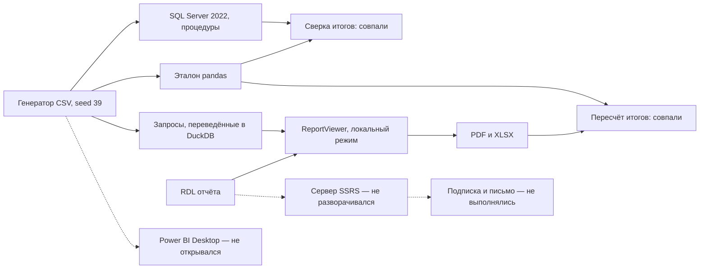

# Отчёты SSRS по продажам и остаткам — конспект

## 1. Зачем

Обещание — освоить SSRS на SQL Server 2022 Developer: развернуть SQL Server с SSRS на Windows, собрать синтетическую базу магазинов, сделать в Report Builder параметризованный отчёт по продажам и остаткам с группировками, настроить рассылку по подписке на e-mail по расписанию и сравнить отчёт с тем же в Power BI.

Итог одной фразой (из [BRIEF](BRIEF.md)): синтетическая база магазинов загружается в SQL Server 2022 Developer, и шесть хранимых процедур отчёта исполняются на нём: списки трёх справочников совпадают с CSV, 148 итогов по строкам `ReportRows` и остаток `StockAtDate` для одной выборки совпадают с независимым расчётом по CSV, `SnapshotDates` возвращает даты снимков, а дата окончания без снимка остатков даёт пустой результат вместо нулевого запаса; параметризованный RDL с каскадом, группами до товара и подсветкой низкого остатка отрисовывается библиотекой ReportViewer в локальном режиме (данные передаёт приложение) в одностраничные PDF и книги Excel с теми же итогами — экспорт сделан до того, как дата окончания получила список дат снимков; запрос подписки и модель Power BI собраны как файлы, а четыре меры DAX модели вычислены движком модели данных Excel и в 600 строках контрольного запроса совпали с расчётом по CSV. Сервер SSRS не развёрнут, отчёт в Report Builder не открывался, рассылка по подписке не отправлялась, модель Power BI в Desktop не обновлялась, поэтому сравнение с Power BI в его интерфейсе не выполнено.

Главное, что нужно помнить: **сервера SSRS в проекте не было**. PDF и Excel нарисовал не сервер, а библиотека ReportViewer внутри небольшого приложения; данные ей подало это приложение, а не запросы, записанные в RDL.

## 2. Задача простыми словами

Директор магазина хочет понять, сколько товара продано за период и сколько осталось на полках к концу периода. Первое число накапливается с каждой продажей. Второе — состояние склада в конкретный момент: если одна коробка лежала на полке неделю, сложение ежедневных остатков посчитает её семь раз. Отчёт должен давать оба числа по регионам, магазинам, категориям и товарам, с выбором периода и фильтров, печататься на одной странице и выгружаться в Excel, где строки раскрываются до товара. Тот же срез нужен в Power BI, чтобы сравнить два подхода.

## 3. Как устроено



Сплошные стрелки — то, что реально выполнялось; пунктир — подготовлено, но не запускалось.

- **Генератор (Python, pandas)** — восемь магазинов в двух регионах, 64 товара в четырёх категориях, продажи и ежедневные снимки остатков за январь 2026 года; seed 39 делает данные воспроизводимыми.
- **SQL Server 2022 Developer** (контейнер Linux в CI) — таблицы, загрузка CSV и шесть хранимых процедур: пять питают наборы данных отчёта (регионы, магазины, категории, даты снимков для параметра «Период по», строки отчёта), шестая — `StockAtDate` — отдельная выборка остатка на дату, она проверена тестом и отчётом не используется.
- **Эталон (pandas)** — независимый расчёт итогов по CSV; с ним сверяются процедуры и экспорты.
- **SQLGlot и DuckDB** — тела запросов отчёта переводятся из T-SQL в диалект DuckDB, чтобы проверить их логику без SQL Server.
- **RDL** — XML-описание постраничного отчёта: источник данных, наборы данных, параметры, таблица с группами, оформление.
- **ReportViewer** — библиотека Microsoft, которая умеет отрисовать RDL без сервера (локальный режим). Источник данных из RDL она при этом не открывает: таблицы ей передаёт приложение.
- **Скрипт подписки** — формирует SOAP-запрос `CreateSubscription` к веб-службе SSRS; проверен только на двойнике транспорта.
- **PBIP** — проект Power BI в виде текстовых файлов: модель с мерами DAX и страница с матрицей и срезами.

## 4. По шагам

**Шаг 1. Данные.** Один снимок хранит число единиц одного товара в одном магазине на конец дня: за 31 день это 31 × 8 × 64 = 15 872 строки остатков. В таблицу продаж попадают только сочетания с положительным количеством — 13 874 строки. Календарь связывает обе таблицы фактов с датами.

**Шаг 2. От фильтра до итога.**
1. Читатель задаёт период и выбирает регионы; список магазинов обновляется по выбранным регионам (каскадный параметр). RDL передаёт выбранные идентификаторы в параметры процедуры: для множественного выбора выражение `Join` собирает строку, а `STRING_SPLIT` внутри процедуры превращает её обратно в набор значений. Текст SQL фиксирован, значения приводятся к целым числам.
2. Процедура `ReportRows` складывает продажи за период для каждого магазина и товара, отдельно выбирает остатки на дату окончания и соединяет две выборки по магазину и товару. Полное внешнее соединение сохраняет товар с остатком и нулевыми продажами. Если на дату окончания снимка нет совсем, процедура не возвращает строк: раньше на этом месте `COALESCE(b.OnHand, 0)` превращал «не знаю» в «на складе ноль», и за 1 января — 1 февраля все 512 позиций выглядели пустыми. Поэтому параметр «Период по» в RDL предлагает только даты, для которых есть снимок (процедура `SnapshotDates`), а при пустом результате отчёт пишет «Нет строк для выбранных параметров…». Если снимок на дату есть, но в нём не хватает отдельных позиций, для них по-прежнему будет 0 — в данных проекта все снимки полные.
3. Tablix — таблица RDL с динамическими группами: строки раскрываются от региона до магазина, категории и товара. Каждая группа делит свою выручку на своё количество: среднее арифметическое цен дало бы маленькому магазину неправильный вес. При нулевых продажах цена пустая. Остаток ниже 8 в товарной строке подсвечивается заливкой; строки групп не подсвечиваются.

**Шаг 3. Проверка на SQL Server.** В CI SQL Server 2022 поднимается в контейнере, скрипты создают базу, загружают CSV и ставят процедуры. Тесты сверяют каждую процедуру по-своему: списки регионов, категорий и магазинов (для одного и двух регионов) — с CSV; строки `ReportRows` складываются отдельным запросом в общий итог и итоги регионов, магазинов и категорий, и эти 148 итогов (количество, выручка, остаток) сравниваются с эталоном; `StockAtDate` — сумма остатка одной выборки; `SnapshotDates` — 31 дата января; дата окончания 1 февраля — пустой результат. Цену процедура не возвращает: её считает отчёт, и проверена она по экспортированным книгам (шаг 4). Первый прогон с проверкой подписей упал и показал ошибку: при загрузке русские подписи регионов и товаров искажались, хотя все числовые тесты проходили. Исправление — загрузка через промежуточный столбец с сортировкой UTF-8. Вывод: сверки сумм недостаточно, подписи нужно сверять отдельно.

**Шаг 4. Отрисовка RDL.** ReportViewer в локальном режиме получил четыре таблицы (`Regions`, `Stores`, `Categories`, `ReportRows`), подготовленные приложением из тех же CSV запросами, переведёнными в DuckDB, и отрисовал RDL для пяти выборок в PDF и XLSX. Экспорт сделан из редакции RDL коммита `cb28892`, до добавления списка дат снимков; текущий RDL не отрисовывался. Скрипт `check_render.py` восстанавливает по уровням группировки книги путь «регион → магазин → категория → товар» и сверяет по нему 143 строки групп с эталоном и 1 664 товарные строки со входными таблицами, пересчитывает 1 812 ячеек цены (выручка, делённая на количество; при нулевых продажах — пусто), проверяет заливку именно ячейки остатка (ниже 8 — оранжевая, ровно 8 — белая, оранжевой вне ячеек остатка нет) и в каждом PDF — одну страницу A4, период, состав регионов и четыре значения каждой печатной строки. Тесты на испорченных копиях доказывают, что перестановку названий, чужую заливку и чужой PDF скрипт ловит. Так проверены раскладка отчёта, группы, итоги, цена, заливка и печать на одну страницу. Не проверены: источник данных и запрос, записанные в RDL, — они не исполнялись; каскад параметров в интерфейсе; подписи параметров (в колонтитуле напечатаны идентификаторы, например «магазины: 2, 6»).

**Шаг 5. Подписка.** Скрипт формирует запрос `CreateSubscription` с расписанием «ежедневно», форматом PDF или Excel и параметрами отчёта. Тест подставляет вместо сети двойник, который возвращает заранее заданный ответ, и проверяет состав запроса и обработку отказа. Элемент `ScheduleDefinition` в `MatchData` записан без пространства имён; какую схему этого XML ожидает сервер, в проекте не установлено — совместимость расписания с SSRS не проверялась.

**Шаг 6. Power BI.** Генератор собирает проект PBIP: модель с двумя таблицами фактов и общими справочниками даты, магазина и товара, мера `Closing Stock` берёт снимок на последнюю дату видимого календаря (`LASTDATE`). Тесты проверяют связи, поля визуальных элементов и воспроизводимость файлов. Power BI Desktop не открывался, поэтому меры DAX вычислил движок модели данных Excel (Power Pivot): тот же язык и те же формулы из TMDL, но другой продукт. Скрипт `excel_dax_check.py` запускает свой Excel через COM, загружает CSV запросами Power Query из модели, создаёт шесть связей и выполняет контрольный запрос `docs/check-measures.dax`: четыре меры в 150 ячейках матрицы (итоги пяти выборок, 143 промежуточных итога, две товарные ячейки 1 января) — 600 строк, у каждой эталон из расчёта pandas и ответ `PASS` или `FAIL`. Все 600 совпали, расхождение 0; две намеренно испорченные строки эталона дали `FAIL`. Сверка нашла различие диалектов: Excel не знает `COALESCE`, поэтому `Revenue` и `Units Sold` переписаны через `SUM(...) + 0` — в DAX `BLANK() + 0` = 0, и в Power BI результат тот же ([протокол](runs/2026-11-21-dax.md)). Параметр `DataFolder` по умолчанию указывает на путь-образец `C:/ssrs-sales-reports/data/` — его нужно заменить на свой в Power BI Desktop или в `expressions.tmdl`; команда `build-pbip` путь не меняет, она записывает значение из константы генератора (см. README).

## 5. Результаты

Источники: полный прогон CI в Linux 19.11.2026 после исправлений по второй внешней проверке ([протокол](runs/2026-11-19-second-audit.md)), первые прогоны на SQL Server 18.11.2026 ([протокол](runs/2026-11-18-mssql.md), [журналы](runs/mssql-evidence.zip)) и экспорт ReportViewer 19.11.2026 ([протокол](runs/2026-11-19-render.md), [пересчёт](runs/2026-11-19-render/check_render.txt)).

| Что | Результат |
|---|---|
| Тесты без сервера в CI | 28 passed за 6,31 с |
| Сверка итогов пяти выборок с эталоном (аудит) | 148 итогов совпали |
| Тесты на SQL Server 2022 в контейнере | 12 passed за 10,40 с, все шесть процедур |
| Меры DAX в модели данных Excel (не Power BI), 21.11.2026 | 4 меры, 600 строк контрольного запроса в 150 ячейках матрицы: 600 PASS, расхождение 0; отрицательный контроль — 2 из 2 `FAIL` |
| Экспорт ReportViewer, локальный режим (версия RDL до добавления списка дат снимков, коммит `cb28892`) | 5 PDF по одной странице A4 и 5 XLSX; 143 строки групп по пути групп и 1 664 товарные строки по полному пути; 1 812 ячеек цены; заливка у 200 ячеек остатка ниже 8, при остатке ровно 8 — 52 белые ячейки |

| Выборка | Продано, шт. | Выручка, ₽ | Средняя цена, ₽/шт. | Остаток, шт. |
|---|---:|---:|---:|---:|
| Весь январь | 55 523 | 3 840 145,58 | 69,16 | 8 727 |
| Январь, регион Север | 27 724 | 1 917 763,30 | 69,17 | 4 365 |
| Январь, Напитки и Фрукты | 27 678 | 1 904 060,02 | 68,79 | 4 309 |
| 8–18 января, магазины 02 и 06 | 5 019 | 346 540,82 | 69,05 | 2 364 |
| Только 1 января | 1 731 | 119 557,07 | 69,07 | 12 022 |

Что следует: процедуры на SQL Server, независимый расчёт по CSV и экспорт RDL дают одни и те же итоги. Весь январь и один его день показывают разное поведение показателей: за месяц продаж больше, а конечный остаток меньше — он не накапливается. Что не следует: что опубликованный на сервере отчёт с собственным источником выдаст то же, что письмо придёт по расписанию и что Power BI покажет те же числа: меры DAX дали их в модели данных Excel, а не в Power BI.

## 6. Как запустить

Офлайн-часть (Python 3.11+, зависимости проекта и группы `dev`, из корня репозитория):

```powershell
$env:PYTHONPATH = 'src'
python -m ssrs_lab generate
python -m ssrs_lab reference
python -m ssrs_lab check-rdl
python -m ssrs_lab check-pbip
python scripts/audit.py --verify-archive docs/runs/offline-evidence.zip
```

Тесты гоняются в CI (Linux): офлайн-задача целиком заняла 34 с, задача с SQL Server — 81 с, из них 44 с запуск контейнера (по сводке прогона в [протоколе второго аудита](runs/2026-11-19-second-audit.md)). Серверу SQL Server задан лимит памяти 2048 МиБ, нужен Docker Compose. Пересчёт экспортов — `python scripts/check_render.py` (`openpyxl` и `pypdf` входят в группу `dev`, в CI это шаг задачи с тестами без сервера). Повтор экспорта ReportViewer — по шагам [протокола экспорта](runs/2026-11-19-render.md) на Windows с .NET Framework.

Сверка мер DAX в модели данных Excel — `python scripts/excel_dax_check.py --formulas` после `python -m ssrs_lab generate` (Windows, Excel, pywin32; вне CI). Сервер SSRS, Report Builder, подписка и Power BI Desktop — по [шагам на стенде](MANUAL_STEPS.md); ничего из этого не выполнялось. Для сервера SSRS и подписки подготовлен ручной workflow на Windows-раннере GitHub (`gh workflow run ssrs-windows.yml`): он ставит SQL Server и SSRS 2022, публикует отчёт, отрисовывает пять выборок, спрашивает у сервера каскад параметров и отправляет письмо подписки на локальный SMTP-приёмник. Workflow ещё не запускался, результатов нет.

## 7. Вопросы на собеседовании

- **Почему остаток называют полуаддитивным?** На одну дату его можно сложить по товарам и магазинам, а между датами — нет: это последовательные наблюдения одного запаса.
- **Что произойдёт, если соединить продажи со снимками без даты?** Обе таблицы имеют ключ «день, магазин, товар». По полному ключу соединение строк не размножает: 13 874 строки продаж так и остаются 13 874. Если забыть день и соединить только по магазину и товару, каждая продажа встретится со всеми 31 снимками своей позиции: 430 094 строки и 1 721 213 единиц вместо 55 523. Но и соединение по полному ключу отчёту не подходит: продажи нужны суммой за период, а остаток — одним снимком на конец периода. Поэтому `ReportRows` сначала агрегирует продажи по магазину и товару, отдельно берёт снимок на дату окончания и только потом соединяет две выборки одного уровня детализации.
- **Что показать, если на дату окончания нет снимка?** Не ноль: отсутствие наблюдения — это «не знаю», а не «пусто на складе». Процедура возвращает пустой результат, параметр даты предлагает только даты снимков.
- **Почему средняя цена меняется при свёртке группы?** Числитель и знаменатель пересчитываются по всем продажам новой группы: продажа трёх единиц весит втрое больше продажи одной.
- **Как устроен каскадный параметр?** Список магазинов — отдельный набор данных, который зависит от выбранных регионов; по умолчанию выбраны все доступные значения. Пустой выбор и «все значения» — разные вещи.
- **Почему строка идентификаторов безопасна для запроса?** Она передаётся параметром, разделяется внутри процедуры, элементы приводятся к целым числам; текст SQL не собирается из ввода.
- **Чем различаются виды подписки?** Стандартная хранит один набор параметров и адресатов. Управляемая данными получает адресатов и параметры из строк отдельного запроса.
- **Зачем фоновой подписке сохранённые учётные данные?** Во время выполнения нет интерактивного пользователя: службе нужен сохранённый доступ к базе, SQL Server Agent как планировщик и настроенная почта (SMTP).
- **Как вы получили PDF без сервера SSRS?** Библиотекой ReportViewer в локальном режиме: она рисует RDL, но данные ей передаёт приложение. Поэтому проверены раскладка, группы, итоги и печать, а не источник данных отчёта и не сервер.
- **Почему проверки сумм оказалось мало?** На SQL Server числа совпали, а русские подписи при загрузке исказились; ошибку поймал отдельный тест подписей.
- **Чем SSRS отличается от Power BI здесь?** SSRS — печатный макет, параметры запроса, расписание и вложения; Power BI — интерактивная матрица со срезами и мерами DAX. В проекте сравнение описано, но Power BI не запускался.
- **Как проверить меры DAX без Power BI Desktop?** Движком модели данных Excel: загрузить те же CSV запросами Power Query, создать связи, передать формулы мер в `DEFINE MEASURE` и выполнить запрос, где каждая строка сама сравнивает меру с эталоном. Язык тот же, но набор функций у движков разный: Excel не знает `COALESCE`, пришлось заменить на `SUM(...) + 0`. Поэтому это проверка формул, а не отчёта Power BI.

## 8. Как говорить честно

Формулировка: «Осваиваю SSRS в учебном проекте по продажам и остаткам магазинов. Написала параметризованный RDL с каскадом регионов и магазинов и группами до товара, хранимые процедуры для SQL Server 2022 и сверила их итоги с независимым расчётом. Отчёт отрисовала в PDF и Excel библиотекой ReportViewer в локальном режиме — без сервера, данные подавало приложение. Подписку и модель Power BI подготовила как файлы. Меры DAX вычислила в модели данных Excel и сверила с расчётом Python по 600 контрольным строкам, но на сервере SSRS и в Power BI Desktop пока не проверяла». Коммерческого опыта с SSRS нет.

Чего проект не доказывает:

- работу сервера SSRS: публикацию RDL, исполнение его собственного источника данных и запроса, каскад параметров в интерфейсе, переключатели групп, подписи параметров в колонтитуле;
- работу в Report Builder — отчёт в нём не открывался;
- подписку через SQL Server Agent с отправкой почты: письмо по расписанию не отправлялось, а совместимость расписания подписки с SSRS не проверялась (схема XML в `ScheduleDefinition` не сверена с сервером);
- что текущий RDL отрисуется так же: сохранённые PDF и книги получены из редакции до добавления списка дат снимков;
- модель PBIP в Power BI Desktop: модель не обновлялась, страница с матрицей и срезами не открывалась, сравнение с Power BI в его интерфейсе не выполнено; меры DAX вычислены движком модели данных Excel, а не Power BI;
- что тот же отчёт с данными из SQL Server на Windows-сервере даст тот же результат — SQL Server проверен в контейнере Linux;
- коммерческий опыт с SSRS и Power BI.

## 9. Глоссарий

- **SSRS** — SQL Server Reporting Services, сервер постраничных отчётов: хранит отчёты, выполняет их запросы, рассылает по подписке.
- **RDL** — XML-описание постраничного отчёта: источник, наборы данных, параметры, макет.
- **Report Builder** — настольный редактор RDL от Microsoft: собирает отчёт, показывает его предпросмотр и публикует на сервер SSRS.
- **ReportViewer** — библиотека для показа и экспорта RDL в приложении; в локальном режиме обходится без сервера, данные даёт приложение.
- **Набор данных** — поля и строки, которые возвращает запрос отчёта.
- **Каскадный параметр** — параметр, доступные значения которого зависят от предыдущего выбора.
- **Tablix** — область отчёта со строками и столбцами, повторяющимися по группам.
- **Снимок остатка** — состояние склада на конец дня; полуаддитивная величина.
- **Средневзвешенная цена** — выручка группы, делённая на её количество.
- **Подписка** — задание SSRS, которое по расписанию выполняет отчёт и доставляет файл, например письмом.
- **SQL Server Agent** — планировщик заданий SQL Server; по нему срабатывают подписки.
- **SOAP** — XML-протокол веб-службы SSRS, через который скрипт создаёт подписку.
- **PBIP** — проект Power BI, хранящий модель и отчёт в отдельных текстовых файлах.
- **Мера DAX** — расчёт Power BI, который выполняется в текущем контексте фильтров.
- **CI** — автоматический прогон проверок и тестов на чистой машине после изменения кода.
- **Контейнер** — изолированный запуск программы (здесь SQL Server) из готового образа.
- **Seed** — начальное число генератора случайных данных: с одним seed данные всегда одинаковы.
- **Двойник транспорта** — подмена сетевого вызова в тесте: возвращает заранее заданный ответ вместо сервера.
